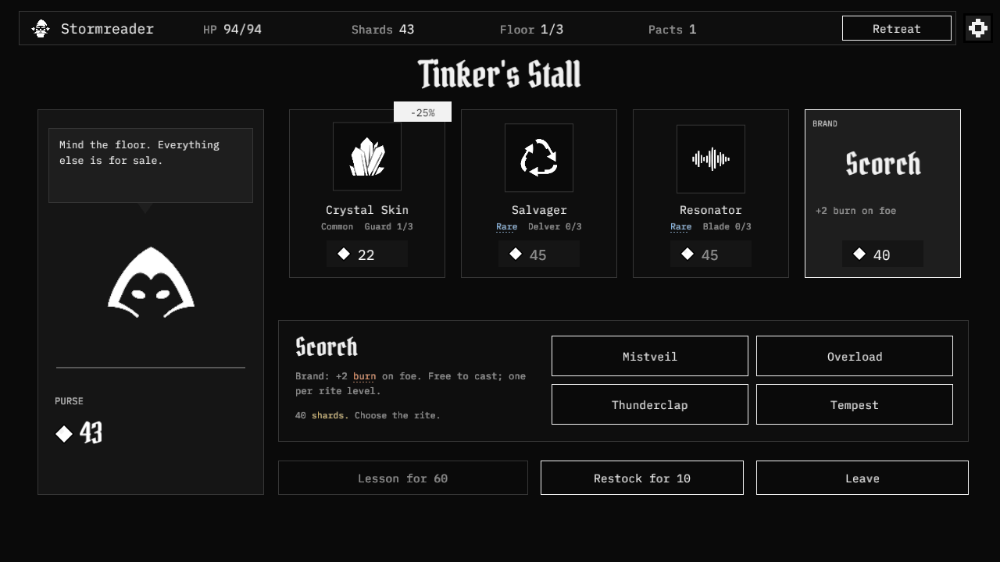
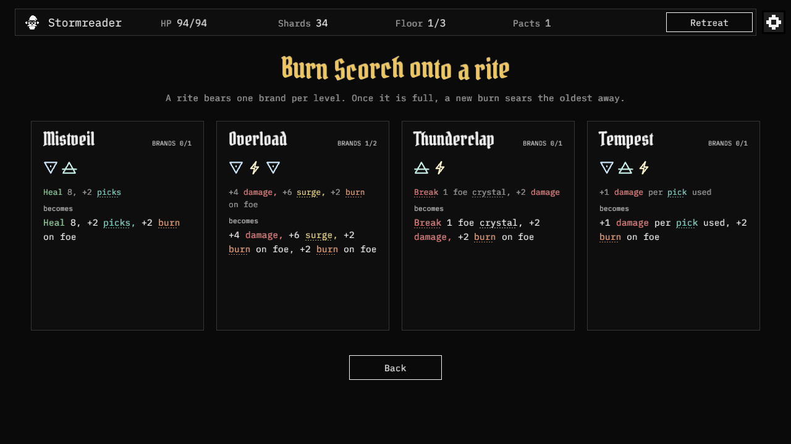

# Minebound

**A roguelike duel played on boards of cracking ground.**

[](https://github.com/Boci0/minebound/releases/latest)
[](https://github.com/Boci0/minebound/actions/workflows/release.yml)


[](LICENSE)

You and your enemy each mine your own boards, one board per element, every tile in view. Mine a
crystal for a gem of that board's element, but every tile around it takes a crack, and a tile with
three cracks caves in on you. Every run starts with three basics, Attack, Shield and Heal, one gem each; rites that need the
right mix of elements are found along the way. Some
rites reach into the enemy's board, breaking its crystals or cracking its ground. Every crystal you
mine builds surge, up to double damage, and every rite you cast spends a step of it, so each turn
asks the same question: fire now, or mine one more? The enemy plays by exactly the same rules, in
full view.


## Contents

- [Features](#features)
- [Installation](#installation)
- [How to play](#how-to-play)
  - [Controls](#controls)
  - [Your boards](#your-boards) and [rites](#rites-and-damage)
  - [Heroes](#heroes), [a run](#a-run), [pacts](#pacts), [brands](#brands), [blessings](#blessings)
  - [Enemies](#enemies), [expeditions](#expeditions), [deeds](#deeds), [the forge](#the-forge) and [tips](#tips)
- [Building from source](#building-from-source)
- [Development](#development)
- [Credits](#credits)
- [License](#license)

## Features

- **Five heroes**, each with their own elements, rites and play style; the fifth is earned with a deed.
- **Deeds** to do across runs, each opening a new pact, brand or hero for every run after.
- **The Forge**: every run banks ore, won or lost. Spend it on permanent **wagers** that make enemies tougher for more ore, or smelt a bespoke one-run **Crucible relic** (2 boons + 1 drawback) carried into your next descent.
- **In-run levelling**: winning battles grants EXP (more from elites and bosses). Each level lets you choose between **+12 max HP & +25 shards** or **deepening your bearer's trait**.
- **A board of cracking ground**: mine crystals in plain view, but every one you take cracks the
  tiles around it, and a tile cracked three times caves in on you.
- **Start with the basics**: every run begins with Attack, Shield and Heal alone. Find up to four
  of 30 rites from elites, treasure and shops, eight for each hero, and upgrade them to level 3.
- **Element reactions**: hit a marked foe with a new element to ignite, douse, gust, crush or arc.
- **Branching runs** across three floors: battles, elites, encounters, shops, shrines, treasure
  and a boss at the end of each floor.
- **57 pacts** in five rarities (mediocre, common, rare, legendary, cursed) that bend the rules of a turn, in six
  **sets**: hold three of one set to wake its bonus. Cursed pacts include both high-risk bargains and pure burdens rolled from random sources.
- **15 brands** to burn onto rites for extra effects, one per rite level.
- **10 blessings**: win a shrine fight to take one. You hold one at a time, and each lifts a single
  stat such as damage, shield, healing or burn.
- **14 enemies**, each breaking one rule: armour, dodging, lifesteal, surge jamming, gem theft
  and more.
- **Six expeditions**, from Shallow Mines to The Null, each harder than the last.
- **One click to cast**: click a basic or a lit rite and it fires. You can still drag gems into a rite to choose which ones it spends.
- **Built-in performance HUD & updater**: toggle semi-transparent FPS and CPU/GPU/RAM graphs and check/install GitHub releases directly from Settings.
- **Seeded runs**: replay any run exactly by its seed.

## Installation

**Requirements:** Windows 10 or 11, 64-bit.

1. Download `Minebound-setup.exe` from the
   [latest release](https://github.com/Boci0/minebound/releases/latest).
2. Run the installer. No administrator rights are needed.
3. Launch Minebound from the Start menu, or from the desktop shortcut if you selected one.

> [!NOTE]
> The installer is not code-signed, so Windows SmartScreen may show "Windows protected your PC".
> Select **More info**, then **Run anyway**.

**Updating:** download the latest `Minebound-setup.exe` and run it. It upgrades the installed game in
place.

**Uninstalling:** open **Settings > Apps > Installed apps**, find Minebound and select
**Uninstall**.

## How to play

### The idea in one minute

You and the enemy each work your own boards, one board per element. Every board holds
**crystals** in plain view. Mine one and it pays you a **gem** of that board's element, but every
tile around it cracks. A tile with three cracks **caves in**: it hurts whoever's board it is on, and
a crystal there is lost. Gems pay for **rites**: spells that need a set mix of elements, such as one
Ember and one Gale. Fill a rite's sockets and it fires at once. You start each run with only the
three **basics**, Attack, Shield and Heal, which take one gem each, and find rites as you go.

Each crystal you mine builds **surge**, which multiplies rite damage, and every rite you cast spends
a step of it. You get only a few picks a turn, and digging a **vent** to ease the pressure costs one
too. So each turn comes down to one question: mine, vent or cast? The enemy plays by exactly the
same rules, and you can watch its board the whole time.

### Controls

| Action | Input |
| --- | --- |
| Mine a crystal | Left click a crystal |
| Dig a vent | Left click a tile without a crystal |
| Switch board | Click a board tab under the board, or press 1 to 3 (free, any time in your turn) |
| Cast a basic or a rite | Click it: it pays its gems from your gem row and fires |
| Socket a gem by dragging | Drag a gem from your gem row (bottom left) onto a rite; it fills the matching socket |
| Take a gem back | Click the filled socket |
| End your turn (unspent gems are kept) | End turn, or Space |
| Explain a rule word | Hover any word that floats |
| Read your hero's trait | Hover your hero's name in battle |
| Abandon the run | Retreat (top right, outside battle) |
| Give up a battle (ends the run) | Surrender (bottom left, in battle) |
| Sound on / off | M |
| Next song | N |
| Volume settings | Esc, or the gear icon |


### Your boards

- Each board is 6 × 6. It holds 8 to 11 crystals and up to 4 tiles of solid rock (hatched), which
  never crack. Every tile is in view.
- A tile's colour shows its cracks: the redder it is, the closer it is to caving in. A third of the
  ground starts with one crack, and about 8 **faults** (one more or one fewer per board) start one
  crack from going. From Ember Depths down, your own boards hold more.
- **Mining** a crystal costs a pick, pays a gem and cracks every tile touching it (up, down, left
  and right). Hover a crystal to see what mining it would bring down.
- A tile with 3 cracks **caves in**: 10 damage straight through shield to you, and a crystal there is lost. It takes nothing
  else down with it.
- A **vent** costs a pick: click any tile without a crystal, and it and every tile touching it lose
  a crack. A tile can be vented again as long as there is a crack to ease.
- You get **4 picks a turn**. Penalties can take some away, but you always keep at least 3.
- You have one board per element, and switching boards is free. A board keeps its state while you
  are on another one. A board with no crystal left to claim is dealt again, and every board is
  dealt fresh at the start of each wave.
- You can hold any number of gems. Gems no rite can use yet wait in your gem row.

### Rites and damage

- A rite's damage is **power × gems spent, plus its bonus**, multiplied by surge. A rite you found adds 4
  more per gem, so it beats spending the same gems on Attack. Hover a rite's
  damage number to see each step that makes it.
- A rite deals damage only if its text says so. Shield, Heal, Lodestone and Sandstorm deal none;
  they only do what they say.
- **Surge**: each crystal you mine this turn adds a step, worth +10%, up to 10 steps (+100%).
  Every rite that deals damage spends one step, so casting early makes later rites weaker. Rites
  that deal no damage spend nothing.
- Casting does not end your turn. Cast, mine some more, and cast again. Once you have no picks left and
  no rite your gems pay for, the turn ends on its own.
- **Shield** soaks damage before HP does. Half of it wears off at the start of its owner's next
  turn. Burn goes straight through it. A **brittle** shield (Lodestone) stays brittle into the next
  wave for as long as the shield lasts. A rite that shatters shields, like Magma, breaks it before it
  can shatter back, and the screen says **PIERCED**.
- **Overpressure**: after turn 12, every rite deals 2 more damage each turn, so no fight can stall
  forever. A warning shows at the top left from turn 9.
- **Loaded rites**: the enemy loads its rites at the end of its turn and fires them as its next
  turn starts. NEXT, under its HP, shows what is loaded, how hard it would hit, and its **break**:
  deal that much rite damage to it in your turn and everything loaded cracks: it still fires, for half.
- Every rite shows the damage it would deal right now, already counting armour, dodges and surge.

**Reactions.** A rite marks its target with its elements. The next rite that hits it bringing an
element not in the mark reacts, once per new element:

| Element | Reaction |
| --- | --- |
| Ember | Ignite: +3 burn on the target |
| Tide | Douse: +4 shield for the caster |
| Gale | Gust: +1 pick for the caster |
| Stone | Crush: +4 damage, before surge |
| Spark | Arc: +2 surge for the caster |

Hover **Marked** in a fighter's stats to see which elements would react.

**Basics.** Every hero starts a run with three flat fallback actions, each paid with one gem of an element set by the
hero (see [Heroes](#heroes)). Basics ignore rite buffs, surge, reactions and marking:

| Basic | Does |
| --- | --- |
| Attack | Your power (flat) |
| Shield | Gain 6 shield (flat) |
| Heal | Heal 4 (flat) |

**Rites** are found during a run: an elite or a treasure lets you choose one of three (or take a
pact instead), and each shop sells one for 55 shards. A hero only finds rites made from its own
elements, and holds at most four; learning a fifth means letting one go, with its levels and
brands. Beating a boss lets you **upgrade** a rite, up to level 3; so can a shop's lesson or a
level found in treasure. Each level renames the rite, raises its numbers by about half, adds one
more gem to its cost, and opens one more brand socket. A level 3 rite is **mastered**: it gains a
trick of its own, with its own look when cast.

| Rite | Gems | Effect at level 1 | Mastered (level 3) | Found by |
| --- | --- | --- | --- | --- |
| Steam Burst | Ember, Tide | +4 damage, +1 pick | Your next 3 cave-ins do no harm | Scaldwright |
| Raze | Ember, Gale | +2 damage, +2 damage per quarter of your HP lost | Heal 50% of its damage | Ashwarden |
| Magma | Ember, Stone | Shatter foe's shield, +3 damage | Can't miss, ignores armour | Ashwarden, Galvanist |
| Plasma | Ember, Spark | +3 damage, +1 damage per surge | Spends no surge | Scaldwright, Galvanist |
| Conduction | Tide, Spark | +3 damage, then +4 surge | Steal 2 foe gems | Stormreader, Deepforger, Scaldwright |
| Sandstorm | Gale, Stone | Foe's attacks halved for 2 turns, crack 2 foe tiles (no damage) | Foe gets 2 fewer picks next turn | Ashwarden |
| Thunderclap | Gale, Spark | Break 1 foe crystal, +2 damage | +8 damage per crystal broken | Stormreader |
| Lodestone | Stone, Spark | Double your shield (adding at most 12, 24 at level 2; no damage), and it turns brittle: the next rite that hits you is blocked, then all of the shield shatters onto the attacker as damage | No limit on the doubling | Deepforger, Galvanist |
| Upheaval | Ember, Gale, Stone | You lose 4 HP, +11 damage | Double damage if the foe is at half HP or below | Ashwarden |
| Tempest | Tide, Gale, Spark | +1 damage per pick used this turn | Unused picks count too | Stormreader |
| Boilover | Ember, Tide, Spark | Burn 3 on foe, +1 damage per burn on the foe | The foe's burn stops fading | Scaldwright |
| Scald Rain | Ember, Tide | +2 damage, burn 5 on foe | Detonate the foe's burn | Scaldwright |
| Kindle | Ember, Gale | +2 power this battle, gain 4 shield | +1 more power this battle | Ashwarden |
| Spark Gap | Ember, Spark | +7 damage as your first rite this turn | Can't miss, ignores armour | Scaldwright, Galvanist |
| Undertow | Tide, Gale | +3 damage, foe gets 1 fewer pick | Foe loses all its gems | Stormreader |
| Tidal Ram | Tide, Stone | Your shield becomes 200% damage | Keep half your shield | Deepforger |
| Iron Thorns | Stone, Spark | Gain 4 shield, +1 thorns this battle | Your shield won't wear off next turn | Deepforger, Galvanist |
| Slag Wall | Ember, Stone | +2 damage, +1 armour this battle, burn 2 on foe | +2 thorns this battle | Ashwarden, Galvanist |
| Monsoon | Tide, Gale | Heal 2 each turn this battle, +1 pick (no damage) | Clear your burn and weaken | Stormreader |
| Sinkhole | Tide, Stone | Foe loses 1 loaded rite, crack 1 foe tile (no damage) | Foe gets 1 fewer pick | Deepforger |
| Wellspring | Tide, Spark | Gain 1 gem of your elements, +2 surge | +1 pick | Stormreader, Deepforger, Scaldwright |
| Erosion | Gale, Stone | +2 damage for each turn of the fight so far | Halve foe's hits for 1 turn | Ashwarden |
| Updraft | Gale, Spark | +2 picks, +2 surge | Your next 2 cave-ins do no harm | Stormreader |
| Ashfall | Ember, Gale, Stone | +4 damage, burn 3 on foe, foe gets 1 fewer pick | The foe's burn stops fading | Ashwarden |
| Stormfront | Tide, Gale, Spark | +5 damage, foe loses 1 loaded rite | Foe gets 2 fewer picks | Stormreader |
| Bastion | Tide, Stone, Spark | +2 armour and heal 2 each turn, this battle (no damage) | Your shield won't wear off next turn | Deepforger |
| Geyser Engine | Tide, Stone, Spark | Gain 1 gem of your elements, gain 6 shield | Steal 2 foe gems | Deepforger |
| Steam Engine | Ember, Tide, Spark | +1 power this battle, +3 surge | +2 picks | Scaldwright |
| Thunder Anvil | Ember, Stone, Spark | +5 damage, +1 armour this battle | +2 power this battle | Galvanist |
| Arc Furnace | Ember, Stone, Spark | +2 damage per surge, gain 1 gem of your elements | Spends no surge | Galvanist |

Enemies cast the first eleven too, plus six no hero finds: Bulwark, Mistveil, Geode Surge,
Forgefire, Maelstrom and Short Circuit.

**Burn** stacks. At the start of its turn, the burning side loses 1 HP per burn, straight through
shield, and then the burn halves. **Detonate** (the Fuse brand) sets off all the burn at once.

### Heroes

All five play by the same rules. Each brings three elements, the element each basic is paid in,
and a trait that keeps them alive.
Galvanist joins once you do the deed Full Company (see [Deeds](#deeds)).

| Hero | HP | Power | Elements | Attack, Shield, Heal paid in | Trait |
| --- | --- | --- | --- | --- | --- |
| Ashwarden | 100 | 7 | Ember, Gale, Stone | Ember, Stone, Gale | +3 power, and every hit on you deals 3 less |
| Stormreader | 94 | 7 | Tide, Gale, Spark | Spark, Tide, Gale | +1 pick each turn; each pick left unused becomes 3 shield |
| Deepforger | 96 | 7 | Tide, Stone, Spark | Spark, Stone, Tide | Shield never wears off, and each point stops 2 damage |
| Scaldwright | 100 | 8 | Ember, Tide, Spark | Ember, Spark, Tide | Rites add 2 burn, burns deal +2, and rites heal 25% of their damage |
| Galvanist | 92 | 7 | Ember, Stone, Spark | Spark, Stone, Ember | Each surge step is worth +15%, and every cave-in on your boards gives 2 surge |

Ashwarden is a berserker who hits harder as he gets hurt. Stormreader turns picks into damage or
shield. Deepforger builds a wall of shield and throws it. Scaldwright stacks burn and cashes it in.
Galvanist rides surge, and even its cave-ins feed it.

### A run


On **The Below**, pick a descent (expedition) and a bearer (hero), then Descend. You start with 20
shards and a choice of one pact from three. A run is **three floors**, each ending in a boss. Beat
the third boss to clear the expedition, which opens the next descent and records your best floor
for that hero.


Each floor is a map of paths, drawn as a closer look at The Below. Pick a room the dotted route
leads to from where you stand. The ground lies turned over round the rooms you have been in and the
ones you may enter next. The first rooms are always battles. The side panel shows your rites, your
blessing and your pacts, plus the floor's **twist**: one random rule for the whole floor that may
help or hurt.

| Node | What happens |
| --- | --- |
| Battle | One to three enemies in a row (more on later floors). Win 18–24 shards. |
| Elite | A normal enemy, then an elite. Win 25–34 shards and choose a rite to learn, or a pact. Appears from the third column; on the first floor from the fourth, and the elite fights alone. |
| Shrine | A normal battle. Win it and choose a **blessing**. Every floor has at least one. |
| Shop | Three pacts (one at 25% off), a brand, a rite to learn, a lesson that levels up a rite (one per shop), and restocks. The last rooms before every boss are shops. |
| Treasure | Choose a rite to learn or a pact, or sometimes a level for a rite or a brand. |
| Encounter | A short event with a choice: shards, max HP or pacts, often for a price or a gamble. No event comes twice in a run. |
| Boss | A floor's boss. Win 40 shards and upgrade one of your rites (or learn one, if you hold none). |

You heal to **full HP after every battle**, so only the fight in front of you can kill you. Damage
does carry from one wave to the next inside a battle.

You can **Retreat** anywhere outside a battle; how far you got still counts. In a battle,
**Surrender** gives up the whole expedition.

### Pacts


Pacts are passive items that bend the rules. They come in five rarities: mediocre (18 shards), common (30),
cursed (22), rare (45) and legendary (65). Rarer ones are offered less often. Cursed bargains trade a real
drawback for strong power and appear everywhere; pure cursed burdens only roll from random grants (Wild Hands,
risky encounters and Wild Gifts), though they still count toward sets and can be swapped or melted. You get
pacts at the start of a run, from treasure, shops, Wild Hands (shown on a reveal screen each floor) and
encounters (shown as full pact cards). In battle they sit at the top left and flash each
time they take effect; if you hold more than fit, the last slot shows **+N** and lists them all
when you hover it.

Each pact belongs to one of six **sets**. Hold three pacts of one set and its bonus wakes for the
rest of the run. Pact cards and shop wares show the set and how many of it you hold, offers lean
toward sets you already hold, and the top bar shows sets two or more deep.

| Set | Bonus at three |
| --- | --- |
| Guard | Every hit on you deals 2 less; gain 5 shield each turn |
| Blade | +1 power |
| Delver | +1 pick each turn |
| Surge | Begin each turn with 5 surge |
| Blood | Heal 5 at the start of each of your turns |
| Cinder | Your rites add 1 burn, and burns deal +2 |



<details>
<summary>All 57 pacts</summary>

| Pact | Rarity | Set | Effect |
| --- | --- | --- | --- |
| Lucky Coin | Common | Delver | The first cave-in on your boards each wave does no harm |
| Dowsing Rod | Common | Delver | Every board you are dealt has 3 cracks propped up |
| Ward Stone | Common | Guard | Gain 10 shield at the start of each wave |
| Field Rations | Common | Blood | Heal 10 whenever a new wave steps in |
| Magpie Purse | Common | Delver | +50% shards from battles |
| Head Start | Common | Surge | Begin each battle with 3 random gems |
| Bramble Coat | Common | Cinder | Enemy rites that hit you cost them 4 HP |
| Saboteur Kit | Common | Delver | +2 faults on every enemy board |
| Sweeper's Map | Common | Delver | 1 fewer fault on each of your boards |
| Shell Fragment | Common | Guard | Gain 4 shield at the start of your turn |
| Whetted Shard | Common | Blade | Your rites deal +5 damage |
| Kindling | Common | Cinder | Your rites set the enemy burning for 3 turns |
| Slow Fuse | Common | Cinder | Your burns deal +2 damage per turn |
| Sap Tap | Common | Blood | Each crystal you mine heals you for 2 |
| Crystal Skin | Common | Guard | Each crystal you mine gives 3 shield |
| Plate Scraps | Common | Guard | Every hit on you deals 2 less |
| Heart Root | Common | Blood | +20 max HP |
| Quick Fingers | Rare | Delver | +1 pick each turn |
| Resonator | Rare | Blade | Each rite's listed damage, shield and healing are 75% stronger |
| Leech Fang | Rare | Blood | Heal for 30% of the damage your rites deal |
| Ambush Wire | Rare | Cinder | Deal 10 damage at the start of each wave |
| Running Start | Rare | Surge | Begin each turn with 6 surge |
| Overcharger | Rare | Surge | Each surge step is worth +17% instead of +10% |
| Steady Hands | Rare | Surge | Surge carries over between your turns |
| Opening Gambit | Rare | Blade | Your first rite each turn deals +100% |
| Resonant Shards | Rare | Cinder | Each crystal you mine zaps the enemy for 3 |
| Salvager | Rare | Delver | Each cave-in on your boards gives a gem of its element |
| Spite Fuse | Rare | Cinder | Each cave-in on your boards also deals 6 damage to the enemy |
| Hourglass | Rare | Guard | Each pick left unused at turn end becomes 3 shield |
| Hoarder's Sack | Rare | Guard | End your turn holding 3+ gems: gain 6 shield |
| Chain Lightning | Rare | Blade | Each rite after your first in a turn deals +5 more than the one before |
| Powder Keg | Rare | Surge | Each cave-in on your boards gives 3 surge |
| Twin Vein | Legendary | Delver | Crystals give 2 gems, but your boards hold 2 more faults |
| Glass Blade | Legendary | Blade | +2 power, but cave-ins deal 2 more damage to you |
| Smoke Bomb | Legendary | Guard | The first enemy rite each turn misses you |
| Sixth Sense | Legendary | Delver | The first cave-in on your boards each turn does no harm |
| Echo Chamber | Legendary | Blade | Your three-element rites fire twice |
| Berserker's Axe | Legendary | Blood | Below half HP, +4 power |
| Scavenger's Hook | Common | Delver | Gain a random gem whenever the enemy's ground caves in (deed: Lordslayer) |
| War Drum | Rare | Blade | +1 power every second turn of a battle (deed: Hoarder) |
| Damper Coil | Rare | Surge | The enemy's surge cannot pass 3 (deed: Set Bound) |
| Bone Pact | Legendary | Blood | +1 power every turn of a battle, but 20 less max HP (deed: Two Paths) |
| Dull Buckler | Mediocre | Guard | Gain 4 shield at the start of each wave |
| Rusty Shiv | Mediocre | Blade | Your rites deal +2 damage |
| Chipped Compass | Mediocre | Delver | Every board you are dealt has 1 crack propped up |
| Bent Copper | Mediocre | Surge | Begin each turn with 2 surge |
| Stale Crust | Mediocre | Blood | Heal 4 whenever a new wave steps in |
| Damp Tinder | Mediocre | Cinder | Your burns deal +1 more damage each turn |
| Cracked Aegis | Cursed | Guard | Every hit on you deals 4 less, but 15 less max HP |
| Serrated Toll | Cursed | Blade | +3 power, but start every wave with 3 burn |
| Greed's Hook | Cursed | Delver | +1 pick each turn, but 1 more fault on each of your boards |
| Frayed Coil | Cursed | Surge | Begin each turn with 7 surge, but cave-ins deal 2 more damage to you |
| Blood Ledger | Cursed | Blood | Heal for 40% of the damage your rites deal, but start every wave with 3 burn |
| Cinder Shackle | Cursed | Cinder | Your rites add 2 burn and burns deal +2, but cave-ins deal 3 more damage to you |
| Lead Weight | Cursed | Guard | -12 max HP, and cave-ins deal 1 more damage to you (random grants only) |
| Rotting Wick | Cursed | Cinder | Start every wave with 2 burn (random grants only) |
| Faulty Lantern | Cursed | Delver | 1 more fault on each of your boards (random grants only) |

</details>

### Brands



Beat an elite and choose one of three brands, then burn it onto one of your rites. Shops sell a
brand too, and treasure sometimes holds them. The rite gains the brand's effect **without costing
an extra gem**. A brand stays at level-1 strength when the rite is upgraded. A rite holds one brand
per level: once its sockets are full, a new brand sears the oldest away. A branded rite shows the brand's name next to
its own.

| Brand | Adds |
| --- | --- |
| Edge | +3 damage |
| Scorch | Burn foe for 2 turns |
| Ward | Gain 5 shield |
| Mend | Heal 4 |
| Hex | Foe's attacks halved for 1 turn |
| Pilfer | Foe loses 1 gem |
| Breach | Shatter foe's shield |
| Tempo | +1 damage per surge |
| Fuse | Detonate foe's burn |
| Insight | +1 pick |
| Fracture | Break 1 foe crystal |
| Snare | Crack 1 foe tile |
| Charge | +2 surge (deed: Heavy Hand) |
| Dazzle | Foe gets 1 fewer pick next turn (deed: Keybearer) |
| Siphon | Heal 25% of its damage (deed: Dawn Delver) |

### Blessings


Win a shrine's fight and choose a blessing from three, or keep the one you have. You hold **one
blessing at a time**; taking a new one lets the old one go. Each lifts a single stat.

| Blessing | Effect |
| --- | --- |
| Blade | Your rites deal +6 damage |
| Might | +2 power |
| Bulwark | Gain 6 shield at the start of each of your turns |
| Iron | Every hit on you deals 3 less |
| Mending | Heal 4 at the start of each of your turns |
| Cinders | Your burns deal +3 damage each turn |
| Leech | Heal for 30% of the damage your rites deal |
| Vigor | +30 max HP |
| Sight | +1 pick each turn |
| Surge | Begin each turn with 4 surge |

### Enemies

Each enemy breaks one rule; the line under its name says which. Hover the words that float for the
details.

| Enemy | Kind | Rule |
| --- | --- | --- |
| Mire Hound | Normal | +1 power every turn |
| Cinder Imp | Normal | Gains a gem whenever your ground caves in |
| Gust Wisp | Normal | The first rite each turn only grazes it, for half damage |
| Pebble Golem | Normal | Every hit deals 2 less |
| Brine Leech | Normal | Heals for half the damage it deals |
| Static Moth | Normal | Jams your surge at 4 |
| Thorn Creeper | Normal | Every rite that hits it deals 2 back |
| Ash Rat | Normal, from floor 2 | Snatches one of your gems as its turn starts |
| The Quarrymaster | Elite, floor 1 | Starts with 8 shield; every hit deals 1 less |
| Crystal Warden | Elite, floor 1 | Each crystal it mines gives it 4 shield |
| The Burrower | Elite, floor 1 | 2 more faults in your boards |
| Gale Duchess | Elite, floor 2 | One extra pick; the first rite each turn only grazes her |
| Flail Sergeant | Elite, floor 2 | Each of its rites after the first in a turn hits 5 harder |
| Iron Tortoise | Elite, floor 2 | Gains 4 shield each turn, and its shield never wears off |
| Kiln Tyrant | Elite, floor 3 | Its rites set you burning, and +1 power every turn |
| The Executioner | Elite, floor 3 | Its first rite each turn hits double |
| The Shade | Elite, floor 3 | The first rite each turn misses it |
| Minelayer Queen | Boss, floor 1 | 1 more fault in your boards; gains a gem whenever your ground caves in |
| The Undertow | Boss, floor 1 | Heals 2 and gains 2 shield each turn |
| Old Tusker | Boss, floor 1 | Starts with 6 shield; below half HP, +2 power |
| The Fen Crone | Boss, floor 1 | Each crystal it mines heals it 2 |
| The Sapper King | Boss, floor 2 | Starts with 12 shield; snatches one of your gems each turn |
| The Tidecaller | Boss, floor 2 | The first rite each turn only grazes her; heals for 30% of damage dealt |
| The Broodmother | Boss, floor 2 | Hits you for 10 as she steps in; 1 more fault in your boards |
| Storm Roc | Boss, floor 2 | Its rites deal +25%; jams your surge at 5 |
| Null Cartographer | Boss, floor 3 | One extra pick, 3 of its cracks propped up; jams your surge at 6 |
| The Deep Engine | Boss, floor 3 | Every hit deals 2 less; +1 power every turn |
| The Wyrm Below | Boss, floor 3 | Its rites set you burning; below half HP, +3 power |
| The Hive Queen | Boss, floor 3 | One extra pick; each of her rites after the first in a turn hits 8 harder |

Each floor's elites come from its own three, and its boss is one of its four, at random; the map shows which one waits for you. Enemies grow tougher
with each floor: normals and elites gain power and much more HP, and bosses gain 40% HP per floor.

### Expeditions

Six descents, each harder than the last. Clearing one opens the next.

| Expedition | Rules |
| --- | --- |
| Shallow Mines | No extra rules |
| Flooded Caverns | Enemies have 10% more HP |
| Ember Depths | Enemies have 10% more HP; bosses gain +1 power every 2 turns; your boards start with about 9 faults |
| Crystal Hollows | Enemies have 15% more HP; bosses gain +1 power every 2 turns; 1 fewer pick each turn; your boards start with about 10 faults |
| The Rift | Every law of Crystal Hollows; every floor's twist is a curse; every rite costs 1 more gem, of any element (Attack, Shield and Heal still take one); your boards start with about 11 faults |
| The Null | Every law of The Rift; enemies have 30% more HP and +1 power; your boards start with about 12 faults |

On The Rift and The Null, the extra gem shows as its own socket on each rite, marked with a ring
cut by a bar. Any element fills it.

<details>
<summary>Floor twists</summary>

| Twist | Effect |
| --- | --- |
| Shallow Seams | 1 fewer fault on each of your boards |
| Tailwind | Begin each turn with 2 surge |
| Second Wind | Heal 6 whenever a new wave steps in |
| Gold Dust | +50% shards from battles |
| Fault Lines | Cave-ins deal 1 more damage to you (curse) |
| Iron Hides | Enemies start each wave with 6 shield (curse) |
| Restless Dead | Enemies have +1 power (curse) |
| Thick Fog | 1 fewer pick each turn (curse) |
| Brittle Ground | 1 more fault on every board, yours and theirs |
| Sharp Edges | Everyone has +1 power |

</details>

### Deeds

Deeds are done once and kept for good. Each opens something new that can come up in every run
after, except the daily descent, which stays the same for everyone. The **Deeds** button on the
map of The Below lists them all, what each asks and what it opens; it lights up when one is newly
done. Progress from before deeds existed counts.

| Deed | Do this | Opens |
| --- | --- | --- |
| Lordslayer | Beat a floor 1 boss | Pact: Scavenger's Hook |
| Heavy Hand | Land a single hit of 100 or more | Brand: Charge |
| Hoarder | Hold 8 pacts at once | Pact: War Drum |
| Set Bound | Wake a pact set: hold 3 pacts of one set | Pact: Damper Coil |
| Keybearer | Carry a secret key | Brand: Dazzle |
| Dawn Delver | Clear a daily descent | Brand: Siphon |
| Two Paths | Clear a descent with two different bearers | Pact: Bone Pact |
| Full Company | Clear a descent with each of the first four bearers | Bearer: Galvanist |

### The Forge

Every run banks **ore** as it ends, won or lost: 2 for each fight won, 10 for each boss and 20 for
each secret ending, more with wagers on. The run's summary says how much. Spend it at the **Forge**,
a button on the map of The Below. The daily descent banks ore too, but never uses wagers, so it stays
the same for everyone.

**Wagers** are bought once, then switched on or off for every descent after. Each one on changes the
enemies and pays more ore.

| Wager | What it does | Ore | Price |
| --- | --- | --- | --- |
| Iron Hides | Enemies have 30% more HP | +25% | 40 |
| Bloodlust | Enemies gain 1 power every second turn | +25% | 40 |
| Brambles | Enemies have 2 thorns | +20% | 40 |
| Glass Foes | Enemies have half HP but 3 more power | +15% | 50 |
| Wild Gifts | Every enemy holds a random pact | +20% | 60 |
| Wild Hands | A random pact for you on every floor | none | 80 |

**The Crucible** is a repeatable ore sink beside Wagers: spend 25 ore to smelt a one-run relic with two random boons and one random drawback, carried into your next non-daily descent and consumed on entry. Reforge all three traits for 20 ore, or **Temper** only the drawback for 15 ore while keeping both boons.

### Tips

- **Hover before you mine.** A crystal shows what mining it would bring down, and the HP it would
  cost you.
- **Vent early.** A tile one crack from caving in is cheap to save, and the vent eases the tiles
  around it too.
- **Mine before you cast.** Surge only grows from mining, and each rite spends a step, so the best
  moment to cast is after your mining is done.
- **Watch NEXT.** If the enemy is about to cast something big, a shield or a weaken (Sandstorm,
  Hex) now beats a little extra damage.
- **Use its board.** Thunderclap, Fracture and Snare break its crystals or crack the ground on the
  board it is mining. Its gems are visible under its board.
- **Waves are where it hurts.** You heal to full between battles, but not between the waves of
  one battle, so a two- or three-wave fight is the one to plan for.
- **Set up for free.** Shield, Heal, Lodestone and Sandstorm spend no surge, so cast them
  before the rite that hits.
- **Spend shards.** They don't carry over between runs.

### Replaying a run

Every run has a seed, shown at the bottom of the map's side panel. Built from source, pass it to
replay the same maps and fights: `cargo run --release -- 42`.

## Building from source

Minebound builds on Windows only: its audio library keeps just the Windows backend. You need
[Git](https://git-scm.com) and [Rust](https://rustup.rs); accept the Visual Studio C++ build tools
when the Rust installer offers them.

```
git clone https://github.com/Boci0/minebound.git
cd minebound
cargo run --release
```

The first build takes a few minutes. To replay a run, pass its seed: `cargo run --release -- 42`.
To update, close the game, run `git pull`, then `cargo run --release` again.

### Other platforms

The game itself (macroquad) is cross-platform; only the audio is Windows-specific. To port it,
restore your platform's backend from upstream [quad-snd 0.2.8](https://crates.io/crates/quad-snd/0.2.8)
into `vendor/quad-snd`, and add its `cfg` line and dependencies back. Each backend is a single
self-contained file; `vendor/quad-snd/README.md` lists what this copy changes. Pull requests are
welcome.

## Development

### Tests

```
cargo test -- --nocapture
```

The suite includes a headless simulation that plays 900 full runs, checking that every fight ends
and that the heroes stay roughly balanced.

### Releasing

Push a version tag. GitHub Actions builds `Minebound-setup.exe` and publishes it as a release:

```
git tag v1.0.1
git push origin v1.0.1
```

The installer is defined in `installer/minebound.iss`. Never change its `AppId`: it is how a new
installer finds and upgrades an existing installation.

## Credits

All assets are CC0 (public domain), except the character and icon glyphs (CC BY 3.0) and the fonts
(SIL Open Font License).

| Asset | Source |
| --- | --- |
| Fonts | [Pirata One](https://fonts.google.com/specimen/Pirata+One) by Rodrigo Fuenzalida and Nicolas Massi; [IBM Plex Mono](https://github.com/IBM/plex) by IBM, both under the [SIL OFL 1.1](https://openfontlicense.org) |
| Characters and icons | Glyphs from [game-icons.net](https://game-icons.net) by Lorc, Delapouite, Skoll, darkZaitzev, Kier Heyl, Faithtoken, PriorBlue and Willdabeast, under [CC BY 3.0](https://creativecommons.org/licenses/by/3.0/), baked into white silhouettes (per-icon list in `assets/sigils/Credits.txt`) |
| Window icon | Tiny Dungeon by [Kenney](https://kenney.nl) |
| Rite effects | [Particle Pack](https://kenney.nl/assets/particle-pack) by Kenney |
| Sound effects | RPG Audio, Impact Sounds, Interface Sounds and Digital SFX by [Kenney](https://kenney.nl); [Horror Hit Soundpack 1](https://opengameart.org/content/horror-hit-soundpack-1) by psychhead_ |
| Music | [Stranger Than Fiction](https://freemusicarchive.org/music/holiznacc0/stranger-than-fiction-halloween-sci-fi), [Gamer Soundtrack: Haunted Mansion](https://freemusicarchive.org/music/holiznacc0/gamer-soundtrack-haunted-mansion), [Horseless Headman](https://freemusicarchive.org/music/holiznacc0/horseless-headman-halloween-beats) by HoliznaCC0; boss music [Hunted By The Evil](https://opengameart.org/content/hunted-by-the-evil), [The Confrontation](https://opengameart.org/content/the-confrontation), [Dark Castle Part I](https://opengameart.org/content/dark-castle-part-i) and [The True Villain Emerges](https://opengameart.org/content/the-true-villain-emerges) by Umplix, [Sinister Abode](https://opengameart.org/content/sinister-abode) by Zane Little Music and [Castle Boss](https://opengameart.org/content/patreon-songs-castle-boss-and-solemn-tide) by madameberry (all CC0). Each floor has its own calm, fight and boss track |

Licence files for each asset pack are in `assets/`. Audio playback uses a patched copy of
[quad-snd](https://github.com/not-fl3/quad-snd) in `vendor/quad-snd` (MIT / Apache-2.0), cut down
to its Windows backend, and drawing uses a patched copy of [macroquad](https://github.com/not-fl3/macroquad)
in `vendor/macroquad` (MIT / Apache-2.0) that sends its font atlases to the GPU once a frame and
packs their glyphs by size.

## License

The game's code is released under the [MIT License](LICENSE). The assets keep their own licences
(all CC0), listed under [Credits](#credits).
