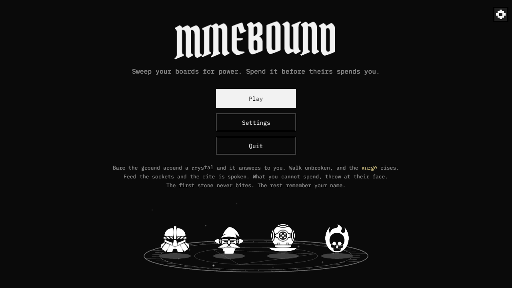
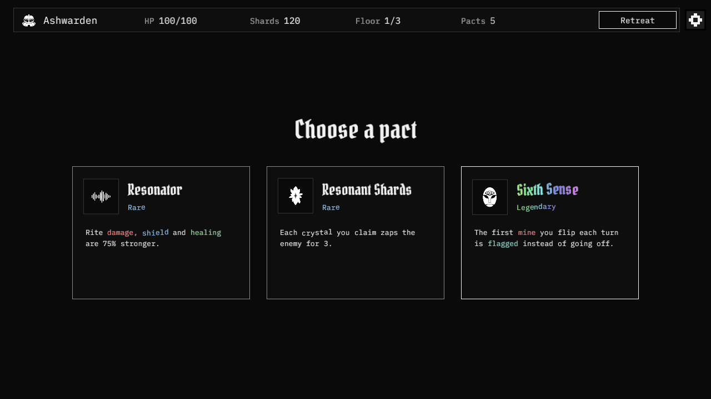

# Minebound

**A roguelike duel played on boards of cracking ground.**

[](https://github.com/Boci0/minebound/releases/latest)
[](https://github.com/Boci0/minebound/actions/workflows/release.yml)


[](LICENSE)

You and your enemy each mine your own boards, one board per element, every tile in view. Mine a
crystal for a gem of that board's element, but every tile around it takes a crack, and a tile with
three cracks caves in on you. Spend your gems on rites that need the right mix of elements. Some
rites reach into the enemy's board, breaking its crystals or cracking its ground. Every crystal you
mine builds surge, up to double damage, and every rite you cast spends a step of it, so each turn
asks the same question: fire now, or mine one more? The enemy plays by exactly the same rules, in
full view.



## Contents

- [Features](#features)
- [Installation](#installation)
- [How to play](#how-to-play)
  - [Controls](#controls) and [the right-click shortcut](#the-right-click-shortcut)
  - [Your boards](#your-boards) and [rites](#rites-and-damage)
  - [Heroes](#heroes), [a run](#a-run), [pacts](#pacts), [brands](#brands), [blessings](#blessings)
  - [Enemies](#enemies), [expeditions](#expeditions) and [tips](#tips)
- [Building from source](#building-from-source)
- [Development](#development)
- [Credits](#credits)
- [License](#license)

## Features

- **Four heroes**, each with their own elements, rites and play style.
- **A board of cracking ground**: mine crystals in plain view, but every one you take cracks the
  tiles around it, and a tile cracked three times caves in on you.
- **Five elements** and 17 rites that need the right mix of gems, each upgradable to level 3.
- **Element reactions**: hit a marked foe with a new element to ignite, douse, gust, crush or arc.
- **Branching runs** across three floors: battles, elites, encounters, shops, shrines, treasure
  and a boss at the end of each floor.
- **38 pacts** in three rarities (common, rare, legendary) that bend the rules of a turn.
- **12 brands**: beat an elite to burn one onto a rite and give it an extra effect.
- **10 blessings**: win a shrine fight to take one. You hold one at a time, and each lifts a single
  stat such as damage, shield, healing or burn.
- **14 enemies**, each breaking one rule: armour, dodging, lifesteal, surge jamming, gem theft
  and more.
- **Six expeditions**, from Shallow Mines to The Null, each harder than the last.
- **Drag or click**: drag gems into a rite, or right click to pick a rite and click gems into it.
- **Seeded runs**: replay any run exactly by its seed.

## Installation

**Requirements:** Windows 10 or 11, 64-bit.

1. Download `Minebound-setup.exe` from the
   [latest release](https://github.com/Boci0/minebound/releases/latest).
2. Run the installer. No administrator rights are needed.
3. Launch Minebound from the Start menu, or from the desktop shortcut if you selected one.

> [!NOTE]
> The installer is not code-signed, so Windows SmartScreen may show "Windows protected your PC".
> Select **More info**, then **Run anyway**.

**Updating:** download the latest `Minebound-setup.exe` and run it. It upgrades the installed game in
place.

**Uninstalling:** open **Settings > Apps > Installed apps**, find Minebound and select
**Uninstall**.

## How to play

### The idea in one minute

You and the enemy each work your own boards, one board per element. Every board holds
**crystals** in plain view. Mine one and it pays you a **gem** of that board's element, but every
tile around it cracks. A tile with three cracks **caves in**: it hurts whoever's board it is on, and
a crystal there is lost. Gems pay for **rites**: spells that need a set mix of elements, such as one
Ember and one Gale. Fill a rite's sockets and it fires at once.

Each crystal you mine builds **surge**, which multiplies rite damage, and every rite you cast spends
a step of it. You get only a few picks a turn, and digging a **vent** to ease the pressure costs one
too. So each turn comes down to one question: mine, vent or cast? The enemy plays by exactly the
same rules, and you can watch its board the whole time.

### Controls

| Action | Input |
| --- | --- |
| Mine a crystal | Left click a crystal |
| Dig a vent | Left click a tile without a crystal |
| Switch board | Click a board tab under the board, or press 1 to 3 (free, any time in your turn) |
| Socket a gem by dragging | Drag a gem from your GEMS row onto a rite; it fills the matching socket |
| Socket a gem by clicking | Right click anywhere off the board to pick a rite, then left click a gem (see below) |
| Take a gem back | Click the filled socket |
| End your turn (unspent gems are kept) | End turn, or Space |
| Explain a rule word | Hover any word that floats |
| Abandon the run | Retreat (top right, outside battle) |
| Give up a battle (ends the run) | Surrender (bottom left, in battle) |
| Sound on / off | M |
| Next song | N |
| Volume settings | Esc, or the gear icon |

#### The right-click shortcut

You don't have to drag gems:

1. **Right click** anywhere off the board. The first rite in your list is picked: it gets a
   frame and a pointer at its left edge.
2. Each further right click moves the pick one rite down, and wraps back to the top after the
   last.
3. **Left click a gem** in your GEMS row. It goes into the picked rite's matching socket. Keep
   clicking gems until the rite is full and fires.

Dragging still works, and dropping a gem on a rite always sends it there, whichever rite is picked. If you click a gem before picking a rite, the
game reminds you to right click first.


### Your boards

- Each board is 6 × 6. It holds 8 to 11 crystals and up to 4 tiles of solid rock (hatched), which
  never crack. Every tile is in view.
- A tile's colour shows its cracks: the redder it is, the closer it is to caving in. A third of the
  ground starts with one crack, and about 8 **faults** (one more or one fewer per board) start one
  crack from going. From Ember Depths down, your own boards hold more.
- **Mining** a crystal costs a pick, pays a gem and cracks every tile touching it (up, down, left
  and right). Hover a crystal to see what mining it would bring down.
- A tile with 3 cracks **caves in**: 6 damage to you, and a crystal there is lost. It takes nothing
  else down with it.
- A **vent** costs a pick: click any tile without a crystal, and it and every tile touching it lose
  a crack. A tile can be vented again as long as there is a crack to ease.
- You get **4 picks a turn**. Penalties can take some away, but you always keep at least 3.
- You have one board per element, and switching boards is free. A board keeps its state while you
  are on another one. A board with no crystal left to claim is dealt again, and every board is
  dealt fresh at the start of each wave.
- You can hold any number of gems. Gems no rite can use yet wait in your GEMS row.

### Rites and damage

- A rite's damage is **power × gems spent, plus its bonus**, multiplied by surge. Hover a rite's
  damage number to see each step that makes it.
- A rite deals damage only if its text says so. Bulwark, Lodestone, Mistveil and Sandstorm deal
  none; they only do what they say.
- **Surge**: each crystal you mine this turn adds a step, worth +10%, up to 10 steps (+100%).
  Every rite that deals damage spends one step, so casting early makes later rites weaker. Rites
  that deal no damage spend nothing.
- Casting does not end your turn. Cast, mine some more, and cast again. Once you have no picks left and
  no rite your gems pay for, the turn ends on its own.
- **Shield** soaks damage before HP does. Half of it wears off at the start of its owner's next
  turn. Burn goes straight through it.
- **Overpressure**: after turn 12, every rite deals 2 more damage each turn, so no fight can stall
  forever.
- **Loaded rites**: the enemy loads its rites at the end of its turn and fires them as its next
  turn starts. NEXT, under its HP, shows what is loaded, how hard it would hit, and its **break**:
  deal that much rite damage to it in your turn and everything loaded shatters unfired.
- Every rite shows the damage it would deal right now, already counting armour, dodges and surge.

**Reactions.** A rite marks its target with its elements. The next rite that hits it bringing an
element not in the mark reacts, once per new element:

| Element | Reaction |
| --- | --- |
| Ember | Ignite: +3 burn on the target |
| Tide | Douse: +4 shield for the caster |
| Gale | Gust: +1 pick for the caster |
| Stone | Crush: +4 damage, before surge |
| Spark | Arc: +2 surge for the caster |

Hover **Marked** in a fighter's stats to see which elements would react.

Each hero can cast four rites: the three made from two of their elements, and the one made from all
three. Beating a boss lets you **upgrade** a rite, up to level 3. Each level renames the rite, raises
its numbers by about half, and adds one more gem to its cost. A level 3 rite is **mastered**: it
gains a trick of its own (last column), with its own look when cast.

| Rite | Gems | Effect at level 1 | Mastered (level 3) |
| --- | --- | --- | --- |
| Steam Burst | Ember, Tide | +4 damage, +1 pick | Your next 3 cave-ins do no harm |
| Raze | Ember, Gale | +2 damage, +2 damage per quarter of your HP lost | Heal 50% of its damage |
| Magma | Ember, Stone | Shatter foe's shield, +3 damage | Can't miss, ignores armour |
| Plasma | Ember, Spark | +3 damage, +1 damage per surge | Spends no surge |
| Mistveil | Tide, Gale | Heal 8, +2 picks (no damage) | Prop up 3 tiles on each of your boards |
| Bulwark | Tide, Stone | Gain 12 shield (no damage) | Your shield won't wear off next turn |
| Conduction | Tide, Spark | +3 damage, then +4 surge | Steal 2 foe gems |
| Sandstorm | Gale, Stone | Foe's attacks halved for 2 turns, crack 2 foe tiles (no damage) | Foe gets 2 fewer picks next turn |
| Thunderclap | Gale, Spark | Break 1 foe crystal, +2 damage | +8 damage per crystal broken |
| Lodestone | Stone, Spark | Double your shield (adding at most 12, 24 at level 2; no damage), and it turns brittle: the next rite that hits you is blocked, then all of the shield shatters onto the attacker as damage | No limit on the doubling |
| Upheaval | Ember, Gale, Stone | You lose 4 HP, +11 damage | Double damage if the foe is at half HP or below |
| Tempest | Tide, Gale, Spark | +1 damage per pick used this turn | Unused picks count too |
| Geode Surge | Tide, Stone, Spark | +6 damage, and your shield becomes 150% damage, then it's gone | Keep half your shield |
| Forgefire | Ember, Stone, Spark | +8 damage | +2 power for the rest of the battle |
| Maelstrom | Tide, Gale, Stone | Gain 6 shield, heal 4 | Clear your burn and weaken |
| Short Circuit | Ember, Gale, Spark | +6 damage, foe loses 1 gem | Foe loses all its gems |
| Boilover | Ember, Tide, Spark | Burn 3 on foe, +1 damage per burn on the foe | The foe's burn stops fading |

**Burn** stacks. At the start of its turn, the burning side loses 1 HP per burn, straight through
shield, and then the burn halves. **Detonate** (the Fuse brand) sets off all the burn at once.

### Heroes

All four play by the same rules. Each brings three elements and a trait that keeps them alive.

| Hero | HP | Power | Elements | Rites | Trait |
| --- | --- | --- | --- | --- | --- |
| Ashwarden | 100 | 7 | Ember, Gale, Stone | Raze, Magma, Sandstorm, Upheaval | Cave-ins deal 1 less damage, and every hit on you 3 less |
| Stormreader | 94 | 7 | Tide, Gale, Spark | Mistveil, Conduction, Thunderclap, Tempest | +1 pick each turn; each pick left unused becomes 3 shield |
| Deepforger | 96 | 6 | Tide, Stone, Spark | Bulwark, Conduction, Lodestone, Geode Surge | Shield never wears off, and each point stops 2 damage |
| Scaldwright | 96 | 6 | Ember, Tide, Spark | Steam Burst, Plasma, Conduction, Boilover | Every rite adds 1 burn on the foe and heals you for 15% of its damage |

Ashwarden is a berserker who hits harder as he gets hurt. Stormreader turns picks into damage or
shield. Deepforger builds a wall of shield and throws it. Scaldwright stacks burn and cashes it in.

### A run


On **The Below**, pick a descent (expedition) and a bearer (hero), then Descend. You start with 20
shards and a choice of one pact from three. A run is **three floors**, each ending in a boss. Beat
the third boss to clear the expedition, which opens the next descent and records your best floor
for that hero.


Each floor is a map of paths, drawn as a closer look at The Below. Pick a room the dotted route
leads to from where you stand. The ground lies turned over round the rooms you have been in and the
ones you may enter next. The first rooms are always battles. The side panel shows your rites, your
blessing and your pacts, plus the floor's **twist**: one random rule for the whole floor that may
help or hurt.

| Node | What happens |
| --- | --- |
| Battle | One to three enemies in a row (more on later floors). Win 18–24 shards. |
| Elite | A normal enemy, then an elite. Win 25–34 shards and a **brand**. Appears from the third column. |
| Shrine | A normal battle. Win it and choose a **blessing**. Every floor has at least one. |
| Shop | Four pacts for sale (one at 25% off), and restocks. |
| Treasure | Choose one pact from three. |
| Encounter | A short event with a choice: shards, max HP or pacts, often for a price or a gamble. |
| Boss | A floor's boss. Win 40 shards and upgrade one of your rites. |

You heal to **full HP after every battle**, so only the fight in front of you can kill you. Damage
does carry from one wave to the next inside a battle.

You can **Retreat** anywhere outside a battle; how far you got still counts. In a battle,
**Surrender** gives up the whole expedition.

### Pacts



Pacts are passive items that bend the rules. They come in three rarities: common (30 shards),
rare (45) and legendary (65). Rarer ones are offered less often. You get them at the start of a
run, from treasure, shops and some encounters. In battle they sit at the top left and flash each
time they take effect; if you hold more than fit, the last slot shows **+N** and lists them all
when you hover it.


<details>
<summary>All 38 pacts</summary>

| Pact | Rarity | Effect |
| --- | --- | --- |
| Lucky Coin | Common | The first cave-in on your boards each wave does no harm |
| Dowsing Rod | Common | Every board you are dealt has 3 cracks propped up |
| Ward Stone | Common | Gain 10 shield at the start of each wave |
| Field Rations | Common | Heal 10 whenever a new wave steps in |
| Magpie Purse | Common | +50% shards from battles |
| Head Start | Common | Begin each battle with 3 random gems |
| Bramble Coat | Common | Enemy rites that hit you cost them 4 HP |
| Saboteur Kit | Common | +2 faults on every enemy board |
| Sweeper's Map | Common | 1 fewer fault on each of your boards |
| Shell Fragment | Common | Gain 4 shield at the start of your turn |
| Whetted Shard | Common | Your rites deal +5 damage |
| Kindling | Common | Your rites set the enemy burning for 3 turns |
| Slow Fuse | Common | Your burns deal +2 damage per turn |
| Sap Tap | Common | Each crystal you mine heals you for 2 |
| Crystal Skin | Common | Each crystal you mine gives 3 shield |
| Plate Scraps | Common | Every hit on you deals 2 less |
| Heart Root | Common | +20 max HP |
| Quick Fingers | Rare | +1 pick each turn |
| Resonator | Rare | Each rite's listed damage, shield and healing are 75% stronger |
| Leech Fang | Rare | Heal for 30% of the damage your rites deal |
| Ambush Wire | Rare | Deal 10 damage at the start of each wave |
| Running Start | Rare | Begin each turn with 6 surge |
| Overcharger | Rare | Each surge step is worth +17% instead of +10% |
| Steady Hands | Rare | Surge carries over between your turns |
| Opening Gambit | Rare | Your first rite each turn deals +100% |
| Resonant Shards | Rare | Each crystal you mine zaps the enemy for 3 |
| Salvager | Rare | Each cave-in on your boards gives a gem of its element |
| Spite Fuse | Rare | Each cave-in on your boards also deals 6 damage to the enemy |
| Hourglass | Rare | Each pick left unused at turn end becomes 3 shield |
| Hoarder's Sack | Rare | End your turn holding 3+ gems: gain 6 shield |
| Chain Lightning | Rare | Each rite after your first in a turn deals +5 more than the one before |
| Powder Keg | Rare | Each cave-in on your boards gives 3 surge |
| Twin Vein | Legendary | Crystals give 2 gems, but your boards hold 2 more faults |
| Glass Blade | Legendary | +2 power, but cave-ins deal 2 more damage to you |
| Smoke Bomb | Legendary | The first enemy rite each turn misses you |
| Sixth Sense | Legendary | The first cave-in on your boards each turn does no harm |
| Echo Chamber | Legendary | Your three-element rites fire twice |
| Berserker's Axe | Legendary | Below half HP, +4 power |

</details>

### Brands


Beat an elite and choose one of three brands, then burn it onto one of your rites. The rite gains
the brand's effect **without costing an extra gem**. A brand stays at level-1 strength when the rite
is upgraded, and a rite holds one brand at a time. A branded rite shows the brand's name next to
its own.

| Brand | Adds |
| --- | --- |
| Edge | +3 damage |
| Scorch | Burn foe for 2 turns |
| Ward | Gain 5 shield |
| Mend | Heal 4 |
| Hex | Foe's attacks halved for 1 turn |
| Pilfer | Foe loses 1 gem |
| Breach | Shatter foe's shield |
| Tempo | +1 damage per surge |
| Fuse | Detonate foe's burn |
| Insight | +1 pick |
| Fracture | Break 1 foe crystal |
| Snare | Crack 1 foe tile |

### Blessings


Win a shrine's fight and choose a blessing from three, or keep the one you have. You hold **one
blessing at a time**; taking a new one lets the old one go. Each lifts a single stat.

| Blessing | Effect |
| --- | --- |
| Blade | Your rites deal +6 damage |
| Might | +2 power |
| Bulwark | Gain 6 shield at the start of each of your turns |
| Iron | Every hit on you deals 3 less |
| Mending | Heal 4 at the start of each of your turns |
| Cinders | Your burns deal +3 damage each turn |
| Leech | Heal for 30% of the damage your rites deal |
| Vigor | +30 max HP |
| Sight | +1 pick each turn |
| Surge | Begin each turn with 4 surge |

### Enemies

Each enemy breaks one rule; the line under its name says which. Hover the words that float for the
details.

| Enemy | Kind | Rule |
| --- | --- | --- |
| Mire Hound | Normal | +1 power every turn |
| Cinder Imp | Normal | Gains a gem whenever your ground caves in |
| Gust Wisp | Normal | The first rite each turn only grazes it, for half damage |
| Pebble Golem | Normal | Every hit deals 2 less |
| Brine Leech | Normal | Heals for half the damage it deals |
| Static Moth | Normal | Jams your surge at 4 |
| Thorn Creeper | Normal | Every rite that hits it deals 2 back |
| Ash Rat | Normal, from floor 2 | Snatches one of your gems as its turn starts |
| The Quarrymaster | Elite | Starts with 8 shield; every hit deals 1 less |
| Gale Duchess | Elite | One extra pick; the first rite each turn only grazes her |
| Kiln Tyrant | Elite | Its rites set you burning, and +1 power every turn |
| Minelayer Queen | Boss, floor 1 | 1 more fault in your boards; gains a gem whenever your ground caves in |
| The Undertow | Boss, floor 1 | Heals 2 and gains 2 shield each turn |
| The Sapper King | Boss, floor 2 | Starts with 12 shield; snatches one of your gems each turn |
| The Tidecaller | Boss, floor 2 | The first rite each turn only grazes her; heals for 30% of damage dealt |
| Null Cartographer | Boss, floor 3 | One extra pick, 3 of its cracks propped up; jams your surge at 6 |
| The Deep Engine | Boss, floor 3 | Every hit deals 2 less; +1 power every turn |

Each floor's boss is one of its two, at random; the map shows which one waits for you.

### Expeditions

Six descents, each harder than the last. Clearing one opens the next.

| Expedition | Rules |
| --- | --- |
| Shallow Mines | No extra rules |
| Flooded Caverns | Enemies have 10% more HP |
| Ember Depths | Enemies have 10% more HP; bosses gain +1 power every 2 turns; your boards start with about 9 faults |
| Crystal Hollows | Enemies have 15% more HP; bosses gain +1 power every 2 turns; 1 fewer pick each turn; your boards start with about 10 faults |
| The Rift | Every law of Crystal Hollows; every floor's twist is a curse; every rite costs 1 more gem, of any element; your boards start with about 11 faults |
| The Null | Every law of The Rift; enemies have 25% more HP and +1 power; your boards start with about 12 faults |

On The Rift and The Null, the extra gem shows as its own socket on each rite, marked with a ring
cut by a bar. Any element fills it.

<details>
<summary>Floor twists</summary>

| Twist | Effect |
| --- | --- |
| Shallow Seams | 1 fewer fault on each of your boards |
| Tailwind | Begin each turn with 2 surge |
| Second Wind | Heal 6 whenever a new wave steps in |
| Gold Dust | +50% shards from battles |
| Fault Lines | Cave-ins deal 1 more damage to you (curse) |
| Iron Hides | Enemies start each wave with 6 shield (curse) |
| Restless Dead | Enemies have +1 power (curse) |
| Thick Fog | 1 fewer pick each turn (curse) |
| Brittle Ground | 1 more fault on every board, yours and theirs |
| Sharp Edges | Everyone has +1 power |

</details>

### Tips

- **Hover before you mine.** A crystal shows what mining it would bring down, and the HP it would
  cost you.
- **Vent early.** A tile one crack from caving in is cheap to save, and the vent eases the tiles
  around it too.
- **Mine before you cast.** Surge only grows from mining, and each rite spends a step, so the best
  moment to cast is after your mining is done.
- **Watch NEXT.** If the enemy is about to cast something big, a shield or a weaken (Sandstorm,
  Hex) now beats a little extra damage.
- **Use its board.** Thunderclap, Fracture and Snare break its crystals or crack the ground on the
  board it is mining. Its gems are visible under its board.
- **Waves are where it hurts.** You heal to full between battles, but not between the waves of
  one battle, so a two- or three-wave fight is the one to plan for.
- **Set up for free.** Bulwark, Lodestone, Mistveil and Sandstorm spend no surge, so cast them
  before the rite that hits.
- **Spend shards.** They don't carry over between runs.

### Replaying a run

Every run has a seed, shown at the bottom of the map's side panel. Built from source, pass it to
replay the same maps and fights: `cargo run --release -- 42`.

## Building from source

Minebound builds on Windows only: its audio library keeps just the Windows backend. You need
[Git](https://git-scm.com) and [Rust](https://rustup.rs); accept the Visual Studio C++ build tools
when the Rust installer offers them.

```
git clone https://github.com/Boci0/minebound.git
cd minebound
cargo run --release
```

The first build takes a few minutes. To replay a run, pass its seed: `cargo run --release -- 42`.
To update, close the game, run `git pull`, then `cargo run --release` again.

### Other platforms

The game itself (macroquad) is cross-platform; only the audio is Windows-specific. To port it,
restore your platform's backend from upstream [quad-snd 0.2.8](https://crates.io/crates/quad-snd/0.2.8)
into `vendor/quad-snd`, and add its `cfg` line and dependencies back. Each backend is a single
self-contained file; `vendor/quad-snd/README.md` lists what this copy changes. Pull requests are
welcome.

## Development

### Tests

```
cargo test -- --nocapture
```

The suite includes a headless simulation that plays 900 full runs, checking that every fight ends
and that the heroes stay roughly balanced.

### Releasing

Push a version tag. GitHub Actions builds `Minebound-setup.exe` and publishes it as a release:

```
git tag v1.0.1
git push origin v1.0.1
```

The installer is defined in `installer/minebound.iss`. Never change its `AppId`: it is how a new
installer finds and upgrades an existing installation.

## Credits

All assets are CC0 (public domain), except the character and icon glyphs (CC BY 3.0) and the fonts
(SIL Open Font License).

| Asset | Source |
| --- | --- |
| Fonts | [Pirata One](https://fonts.google.com/specimen/Pirata+One) by Rodrigo Fuenzalida and Nicolas Massi; [IBM Plex Mono](https://github.com/IBM/plex) by IBM, both under the [SIL OFL 1.1](https://openfontlicense.org) |
| Characters and icons | Glyphs from [game-icons.net](https://game-icons.net) by Lorc, Delapouite, Skoll, darkZaitzev, Kier Heyl, Faithtoken, PriorBlue and Willdabeast, under [CC BY 3.0](https://creativecommons.org/licenses/by/3.0/), baked into white silhouettes (per-icon list in `assets/sigils/Credits.txt`) |
| Window icon | Tiny Dungeon by [Kenney](https://kenney.nl) |
| Rite effects | [Particle Pack](https://kenney.nl/assets/particle-pack) by Kenney |
| Sound effects | RPG Audio, Impact Sounds, Interface Sounds and Digital SFX by [Kenney](https://kenney.nl); [Horror Hit Soundpack 1](https://opengameart.org/content/horror-hit-soundpack-1) by psychhead_ |
| Music | [Stranger Than Fiction](https://freemusicarchive.org/music/holiznacc0/stranger-than-fiction-halloween-sci-fi), [Gamer Soundtrack: Haunted Mansion](https://freemusicarchive.org/music/holiznacc0/gamer-soundtrack-haunted-mansion), [Horseless Headman](https://freemusicarchive.org/music/holiznacc0/horseless-headman-halloween-beats) and [The Hero And The Haunting](https://freemusicarchive.org/music/holiznacc0/the-hero-and-the-haunting) by HoliznaCC0 |

Licence files for each asset pack are in `assets/`. Audio playback uses a patched copy of
[quad-snd](https://github.com/not-fl3/quad-snd) in `vendor/quad-snd` (MIT / Apache-2.0), cut down
to its Windows backend, and drawing uses a patched copy of [macroquad](https://github.com/not-fl3/macroquad)
in `vendor/macroquad` (MIT / Apache-2.0) that sends its font atlases to the GPU once a frame and
packs their glyphs by size.

## License

The game's code is released under the [MIT License](LICENSE). The assets keep their own licences
(all CC0), listed under [Credits](#credits).
