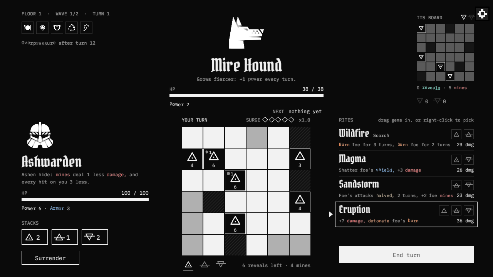
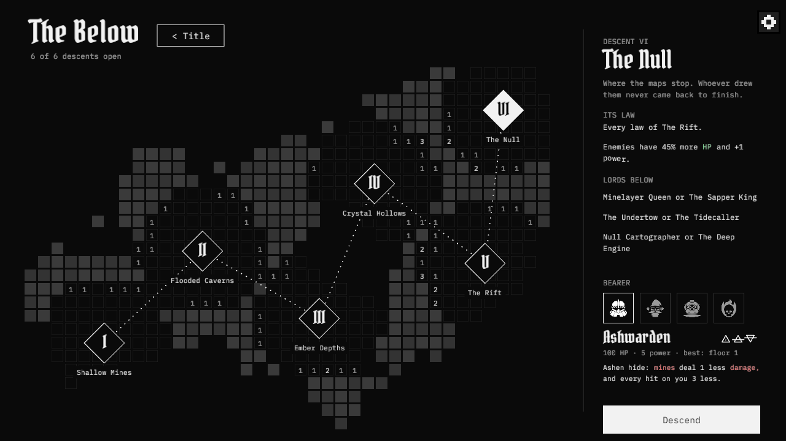
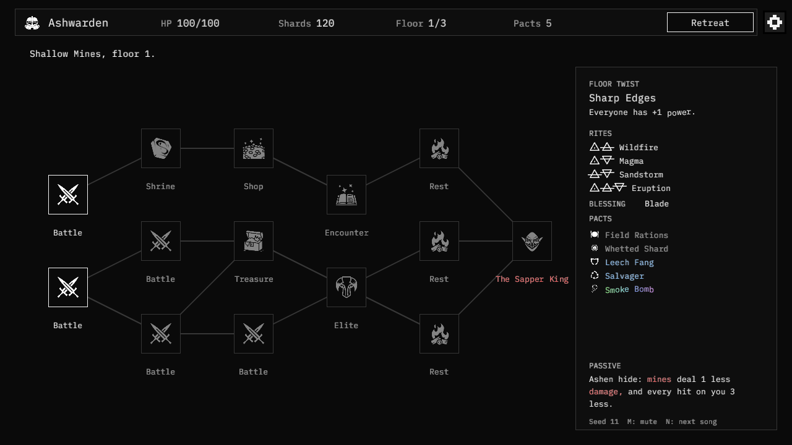
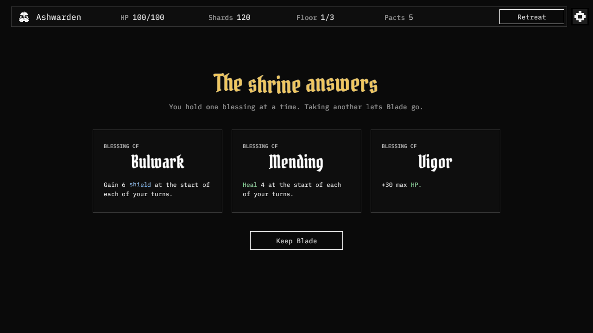

# Minebound

**A roguelike duel played on minesweeper boards.**

[](https://github.com/Boci0/minebound/releases/latest)
[](https://github.com/Boci0/minebound/actions/workflows/release.yml)


[](LICENSE)

You and your enemy each sweep your own boards, one board per element. Crystals are always visible;
mines are not. Clear every safe tile around a crystal to claim a stack of that board's element, then
spend your stacks on rites that need the right mix of elements. Some rites reach into the enemy's
board, breaking its crystals or burying more mines. Every safe flip in a row builds surge, up to
double damage, and every rite you cast spends a step of it, so each turn asks the same question:
fire now, or flip one more? The enemy plays by exactly the same rules, in full view.


## Contents

- [Features](#features)
- [Installation](#installation)
- [How to play](#how-to-play)
  - [Controls](#controls) and [the right-click shortcut](#the-right-click-shortcut)
  - [Your boards](#your-boards) and [rites](#rites-and-damage)
  - [Heroes](#heroes), [a run](#a-run), [pacts](#pacts), [brands](#brands), [blessings](#blessings)
  - [Enemies](#enemies), [expeditions](#expeditions) and [tips](#tips)
- [Building from source](#building-from-source)
- [Development](#development)
- [Credits](#credits)
- [License](#license)

## Features

- **Four heroes**, each with their own elements, rites and play style.
- **Five elements** and 17 rites that need the right mix of gems, each upgradable to level 3.
- **Branching runs** across three floors: battles, elites, encounters, shops, shrines, rest sites,
  treasure and a boss at the end of each floor.
- **38 pacts** in three rarities (common, rare, legendary) that bend the rules of a turn.
- **12 brands**: beat an elite to burn one onto a rite and give it an extra effect.
- **10 blessings**: win a shrine fight to take one. You hold one at a time, and each lifts a single
  stat such as damage, shield, healing or burn.
- **14 enemies**, each breaking one rule: armour, dodging, lifesteal, surge jamming, stack theft
  and more.
- **Six expeditions**, from Shallow Mines to The Null, each harder than the last.
- **Drag or click**: drag gems into a rite, or right click to pick a rite and click gems into it.
- **Seeded runs**: replay any run exactly by its seed.

## Installation

**Requirements:** Windows 10 or 11, 64-bit.

1. Download `Minebound-setup.exe` from the
   [latest release](https://github.com/Boci0/minebound/releases/latest).
2. Run the installer. No administrator rights are needed.
3. Launch Minebound from the Start menu, or from the desktop shortcut if you selected one.

> [!NOTE]
> The installer is not code-signed, so Windows SmartScreen may show "Windows protected your PC".
> Select **More info**, then **Run anyway**.

**Updating:** download the latest `Minebound-setup.exe` and run it. It upgrades the installed game in
place.

**Uninstalling:** open **Settings > Apps > Installed apps**, find Minebound and select
**Uninstall**.

## How to play

### The idea in one minute

You and the enemy each sweep your own minesweeper boards, one board per element. Every board holds
a few **crystals**. Reveal every safe tile around a crystal and it pays you a **gem** of that
board's element. Gems pay for **rites**: spells that need a set mix of elements, such as one Ember
and one Gale. Fill a rite's sockets and it fires at once.

Safe flips in a row build **surge**, which multiplies rite damage, and every rite you cast spends a
step of it. A mine ends your turn and wipes your surge. So each turn comes down to one question:
cast now, or risk one more flip? The enemy plays by exactly the same rules, and you can watch its
board the whole time.

### Controls

| Action | Input |
| --- | --- |
| Reveal a tile | Left click on the board |
| Flag a suspected mine | Right click on the board |
| Switch board | Click a board tab under the board (free, any time in your turn) |
| Socket a gem by dragging | Drag a gem from your stacks onto a rite; it fills the matching socket |
| Socket a gem by clicking | Right click anywhere off the board to pick a rite, then left click a gem (see below) |
| Take a gem back | Click the filled socket |
| End your turn (unspent gems are kept) | End turn, or Space |
| Explain a rule word | Hover any word that floats |
| Abandon the run | Retreat (top right, outside battle) |
| Give up a battle (ends the run) | Surrender (bottom left, in battle) |
| Sound on / off | M |
| Next song | N |
| Volume settings | Esc, or the gear icon |

#### The right-click shortcut

You don't have to drag gems:

1. **Right click** anywhere off the minefield. The first rite in your list is picked: it gets a
   frame and a pointer at its left edge.
2. Each further right click moves the pick one rite down, and wraps back to the top after the
   last.
3. **Left click a gem** in your stacks. It goes into the picked rite's matching socket. Keep
   clicking gems until the rite is full and fires.

Right clicks on the board still flag mines. Dragging still works, and dropping a gem on a rite
always sends it there, whichever rite is picked. If you click a gem before picking a rite, the
game reminds you to right click first.



### Your boards

- Each board is 6 × 6. It holds about 5 mines, 4 to 6 crystals and up to 6 tiles of solid rock
  (hatched), which never flip and need no clearing.
- A number on a tile is how many mines touch it. A safe tile that touches no mines opens its
  neighbours too.
- Your first flip on a fresh board is never a mine.
- A crystal shows two numbers: the big one is how many hidden tiles still surround it, the small one
  in its corner is how many of those are mines. It pays out once every safe tile around it is
  revealed.
- You get **6 reveals a turn**. Penalties can take some away, but you always keep at least 5.
  Flags are free.
- A mine costs 2 HP, ends your turn, wipes your surge and breaks the crystals next to it.
- You have one board per element, and switching boards is free. A board keeps its state while you
  are on another one. A board with no crystal left to claim is dealt again, and every board is
  dealt fresh at the start of each wave.
- You can hold any number of gems. Gems no rite can use yet wait in your stacks.

### Rites and damage

- A rite's damage is **power × gems spent, plus its bonus**, multiplied by surge.
- **Surge**: each safe flip in a row this turn adds a step, worth +20%, up to 5 steps (+100%).
  Every rite you cast spends one step, so casting early makes later rites weaker. A mine wipes
  all your surge.
- Casting does not end your turn. Cast, flip some more, and cast again.
- **Shield** soaks damage before HP does. Half of it wears off at the start of its owner's next
  turn. Burn goes straight through it.
- **Overpressure**: after turn 12, every rite deals 2 more damage each turn, so no fight can stall
  forever.
- The enemy's next rite is shown under its HP (NEXT), and every rite shows the damage it would deal
  right now, already counting armour, dodges and surge.

Each hero can cast four rites: the three made from two of their elements, and the one made from all
three. Beating a boss lets you **upgrade** a rite, up to level 3. Each level renames the rite, raises
its numbers by about half, and adds one more gem to its cost.

| Rite | Gems | Effect at level 1 |
| --- | --- | --- |
| Steam Burst | Ember, Tide | +4 damage, +1 reveal |
| Wildfire | Ember, Gale | Burn foe for 3 turns |
| Magma | Ember, Stone | Shatter foe's shield, +3 damage |
| Plasma | Ember, Spark | +3 damage, +1 damage per surge |
| Mistveil | Tide, Gale | Heal 4, +3 damage |
| Bulwark | Tide, Stone | Gain 7 shield |
| Conduction | Tide, Spark | Foe loses 2 stacks, +3 damage |
| Sandstorm | Gale, Stone | Foe's attacks halved for 2 turns, +2 foe mines |
| Thunderclap | Gale, Spark | Break 1 foe crystal, +2 damage |
| Lodestone | Stone, Spark | Gain 4 shield, +4 damage |
| Eruption | Ember, Gale, Stone | +7 damage, detonate foe's burn |
| Tempest | Tide, Gale, Spark | +6 damage, heal 2 |
| Geode Surge | Tide, Stone, Spark | +6 damage, gain 6 shield |
| Forgefire | Ember, Stone, Spark | +8 damage |
| Maelstrom | Tide, Gale, Stone | Gain 6 shield, heal 4 |
| Short Circuit | Ember, Gale, Spark | +6 damage, foe loses 1 stack |
| Boilover | Ember, Tide, Spark | Burn foe for 2 turns, +5 damage |

**Burn** costs its target 2 HP at the start of each of its turns, for the turns shown.
**Detonate** sets off all the burn left at once.

### Heroes

All four play by the same rules. Each brings three elements and a trait that keeps them alive.

| Hero | HP | Elements | Rites | Trait |
| --- | --- | --- | --- | --- |
| Ashwarden | 100 | Ember, Gale, Stone | Wildfire, Magma, Sandstorm, Eruption | Mines deal 1 less damage, and every hit on you 3 less |
| Stormreader | 94 | Tide, Gale, Spark | Mistveil, Conduction, Thunderclap, Tempest | +1 reveal each turn; each reveal left unused becomes 3 shield |
| Deepforger | 96 | Tide, Stone, Spark | Bulwark, Conduction, Lodestone, Geode Surge | 10 shield at the start of each wave, 2 more every turn |
| Scaldwright | 96 | Ember, Tide, Spark | Steam Burst, Plasma, Conduction, Boilover | Rites burn the foe for 3 turns and heal you for 15% of their damage |

Every hero starts with 5 power.

### A run



On **The Below**, pick a descent (expedition) and a bearer (hero), then Descend. You start with 20
shards and a choice of one pact from three. A run is **three floors**, each ending in a boss. Beat
the third boss to clear the expedition, which opens the next descent and records your best floor
for that hero.



Each floor is a map of paths. Pick a node in the next column to move on. The first column is always
a battle, and the column before the boss is all rest sites. The side panel shows your rites, your
blessing and your pacts, plus the floor's **twist**: one random rule for the whole floor that may
help or hurt.

| Node | What happens |
| --- | --- |
| Battle | One to three enemies in a row (more on later floors). Win 18–24 shards and 5 HP back. |
| Elite | A normal enemy, then an elite. Win 25–34 shards and a **brand**. Appears from the third column. |
| Shrine | A normal battle. Win it and choose a **blessing**. Every floor has at least one. |
| Shop | Four pacts for sale (one at 25% off), 18 HP for 20 shards, and restocks. |
| Treasure | Choose one pact from three. |
| Encounter | A short event with a choice: shards, HP, max HP or pacts, often for a price or a gamble. |
| Rest | Sleep (heal 30% of max HP) or train (+5 max HP). |
| Boss | A floor's boss. Win 40 shards and upgrade one of your rites. |

You can **Retreat** anywhere outside a battle; how far you got still counts. In a battle,
**Surrender** gives up the whole expedition.

### Pacts


Pacts are passive items that bend the rules. They come in three rarities: common (30 shards),
rare (45) and legendary (65). Rarer ones are offered less often. You get them at the start of a
run, from treasure, shops and some encounters. In battle they sit at the top left and flash each
time they take effect; if you hold more than fit, the last slot shows **+N** and lists them all
when you hover it.


<details>
<summary>All 38 pacts</summary>

| Pact | Rarity | Effect |
| --- | --- | --- |
| Lucky Coin | Common | The first mine you hit each wave is a dud |
| Dowsing Rod | Common | 3 mines start flagged on each of your boards |
| Ward Stone | Common | Gain 10 shield at the start of each wave |
| Field Rations | Common | Heal 10 after every battle |
| Magpie Purse | Common | +50% shards from battles |
| Head Start | Common | Begin each battle with 3 random stacks |
| Bramble Coat | Common | Enemy rites that hit you cost them 4 HP |
| Saboteur Kit | Common | +2 mines on every enemy board |
| Sweeper's Map | Common | 1 fewer mine on each of your boards |
| Shell Fragment | Common | Gain 4 shield at the start of your turn |
| Whetted Shard | Common | Your rites deal +5 damage |
| Kindling | Common | Your rites set the enemy burning for 3 turns |
| Slow Fuse | Common | Your burns deal +2 damage per turn |
| Sap Tap | Common | Each crystal you claim heals you for 2 |
| Crystal Skin | Common | Each crystal you claim gives 3 shield |
| Plate Scraps | Common | Every hit on you deals 2 less |
| Heart Root | Common | +20 max HP |
| Quick Fingers | Rare | +1 reveal each turn |
| Resonator | Rare | Rite damage, shield and healing are 75% stronger |
| Leech Fang | Rare | Heal for 30% of the damage your rites deal |
| Ambush Wire | Rare | Deal 10 damage at the start of each wave |
| Running Start | Rare | Begin each turn with 3 surge |
| Overcharger | Rare | Each surge step is worth +35% instead of +20% |
| Steady Hands | Rare | Surge carries over between your turns; mines still wipe it |
| Opening Gambit | Rare | Your first rite each turn deals +100% |
| Resonant Shards | Rare | Each crystal you claim zaps the enemy for 3 |
| Salvager | Rare | Crystals you break with a mine still pay out |
| Spite Fuse | Rare | Mines you hit also deal 6 damage to the enemy |
| Hourglass | Rare | Each reveal left unused at turn end becomes 3 shield |
| Hoarder's Sack | Rare | End your turn holding 3+ stacks: 2 shield per stack |
| Chain Lightning | Rare | Each rite after your first in a turn deals +5 more than the one before |
| Powder Keg | Rare | Mines no longer end your turn; they still hurt and wipe surge |
| Twin Vein | Legendary | Crystals give 2 stacks, but your boards hold 2 more mines |
| Glass Blade | Legendary | +2 power, but mines deal 2 more damage to you |
| Smoke Bomb | Legendary | The first enemy rite each turn misses you |
| Sixth Sense | Legendary | The first mine you flip each turn is flagged instead of going off |
| Echo Chamber | Legendary | Your three-element rites fire twice |
| Berserker's Axe | Legendary | Below half HP, +4 power |

</details>

### Brands


Beat an elite and choose one of three brands, then burn it onto one of your rites. The rite gains
the brand's effect **without costing an extra gem**. A brand stays at level-1 strength when the rite
is upgraded, and a rite holds one brand at a time. A branded rite shows the brand's name next to
its own.

| Brand | Adds |
| --- | --- |
| Edge | +3 damage |
| Scorch | Burn foe for 2 turns |
| Ward | Gain 5 shield |
| Mend | Heal 4 |
| Hex | Foe's attacks halved for 1 turn |
| Pilfer | Foe loses 1 stack |
| Breach | Shatter foe's shield |
| Tempo | +1 damage per surge |
| Fuse | Detonate foe's burn |
| Insight | +1 reveal |
| Fracture | Break 1 foe crystal |
| Snare | +1 foe mine |

### Blessings



Win a shrine's fight and choose a blessing from three, or keep the one you have. You hold **one
blessing at a time**; taking a new one lets the old one go. Each lifts a single stat.

| Blessing | Effect |
| --- | --- |
| Blade | Your rites deal +6 damage |
| Might | +2 power |
| Bulwark | Gain 6 shield at the start of each of your turns |
| Iron | Every hit on you deals 3 less |
| Mending | Heal 4 at the start of each of your turns |
| Cinders | Your burns deal +3 damage each turn |
| Leech | Heal for 30% of the damage your rites deal |
| Vigor | +30 max HP |
| Sight | +1 reveal each turn |
| Surge | Begin each turn with 2 surge |

### Enemies

Each enemy breaks one rule; the line under its name says which. Hover the words that float for the
details.

| Enemy | Kind | Rule |
| --- | --- | --- |
| Mire Hound | Normal | +1 power every turn |
| Cinder Imp | Normal | Gains a stack whenever you hit a mine |
| Gust Wisp | Normal | The first rite each turn only grazes it, for half damage |
| Pebble Golem | Normal | Every hit deals 2 less |
| Brine Leech | Normal | Heals for half the damage it deals |
| Static Moth | Normal | Jams your surge at 2 |
| Thorn Creeper | Normal | Every rite that hits it deals 2 back |
| Ash Rat | Normal | Snatches one of your stacks as its turn starts |
| The Quarrymaster | Elite | Starts with 8 shield; every hit deals 1 less |
| Gale Duchess | Elite | One extra reveal; the first rite each turn only grazes her |
| Kiln Tyrant | Elite | Burns harder, and +1 power every turn |
| Minelayer Queen | Boss, floor 1 | 1 extra mine in your boards; gains a stack when you hit one |
| The Sapper King | Boss, floor 1 | Starts with 6 shield; snatches one of your stacks each turn |
| The Undertow | Boss, floor 2 | Heals 2 and gains 2 shield each turn |
| The Tidecaller | Boss, floor 2 | The first rite each turn only grazes her; heals for 30% of damage dealt |
| Null Cartographer | Boss, floor 3 | One extra reveal, 3 mines pre-flagged; jams your surge at 3 |
| The Deep Engine | Boss, floor 3 | Every hit deals 2 less; +1 power every turn |

Each floor's boss is one of its two, at random; the map shows which one waits for you.

### Expeditions

Six descents, each harder than the last. Clearing one opens the next.

| Expedition | Rules |
| --- | --- |
| Shallow Mines | No extra rules |
| Flooded Caverns | Enemies have 15% more HP |
| Ember Depths | Enemies have 15% more HP; bosses gain +1 power every turn |
| Crystal Hollows | Enemies have 30% more HP; bosses gain +1 power every turn; 1 fewer reveal each turn |
| The Rift | Every law of Crystal Hollows; every floor's twist is a curse; every rite costs 1 more gem, of any element |
| The Null | Every law of The Rift; enemies have 45% more HP and +1 power |

On The Rift and The Null, the extra gem shows as its own socket on each rite, marked with a ring
cut by a bar. Any element fills it.

<details>
<summary>Floor twists</summary>

| Twist | Effect |
| --- | --- |
| Shallow Seams | 1 fewer mine on each of your boards |
| Tailwind | Begin each turn with 1 surge |
| Second Wind | Heal 6 more after every battle |
| Gold Dust | +50% shards from battles |
| Fault Lines | Mines deal 1 more damage to you (curse) |
| Iron Hides | Enemies start each wave with 6 shield (curse) |
| Restless Dead | Enemies have +1 power (curse) |
| Thick Fog | 1 fewer reveal each turn (curse) |
| Brittle Ground | 1 more mine on every board, yours and theirs |
| Sharp Edges | Everyone has +1 power |

</details>

### Tips

- **Read the crystal's corner number.** When it matches the flags around the crystal, every other
  tile next to it is safe.
- **Flip before you cast.** Surge only grows from safe flips, and each rite spends a step, so the
  best moment to cast is after your safe flips and before a risky one.
- **Watch NEXT.** If the enemy is about to cast something big, a shield or a weaken (Sandstorm,
  Hex) now beats a little extra damage.
- **Use its board.** Thunderclap, Fracture and Snare break its crystals or bury mines on the board
  it is sweeping. Its gems are visible under its board.
- **Rest before the boss.** The column before each boss is all rest sites. Sleep if you are low,
  train if you are not.
- **Spend shards.** They don't carry over between runs.

### Replaying a run

Every run has a seed, shown at the bottom of the map's side panel. Built from source, pass it to
replay the same maps and fights: `cargo run --release -- 42`.

## Building from source

Minebound builds on Windows only: its audio library keeps just the Windows backend. You need
[Git](https://git-scm.com) and [Rust](https://rustup.rs); accept the Visual Studio C++ build tools
when the Rust installer offers them.

```
git clone https://github.com/Boci0/minebound.git
cd minebound
cargo run --release
```

The first build takes a few minutes. To replay a run, pass its seed: `cargo run --release -- 42`.
To update, close the game, run `git pull`, then `cargo run --release` again.

### Other platforms

The game itself (macroquad) is cross-platform; only the audio is Windows-specific. To port it,
restore your platform's backend from upstream [quad-snd 0.2.8](https://crates.io/crates/quad-snd/0.2.8)
into `vendor/quad-snd`, and add its `cfg` line and dependencies back. Each backend is a single
self-contained file; `vendor/quad-snd/README.md` lists what this copy changes. Pull requests are
welcome.

## Development

### Tests

```
cargo test -- --nocapture
```

The suite includes a headless simulation that plays 900 full runs, checking that every fight ends
and that the heroes stay roughly balanced.

### Releasing

Push a version tag. GitHub Actions builds `Minebound-setup.exe` and publishes it as a release:

```
git tag v1.0.0
git push origin v1.0.0
```

The installer is defined in `installer/minebound.iss`. Never change its `AppId`: it is how a new
installer finds and upgrades an existing installation.

## Credits

All assets are CC0 (public domain), except the character and icon glyphs (CC BY 3.0) and the fonts
(SIL Open Font License).

| Asset | Source |
| --- | --- |
| Fonts | [Pirata One](https://fonts.google.com/specimen/Pirata+One) by Rodrigo Fuenzalida and Nicolas Massi; [IBM Plex Mono](https://github.com/IBM/plex) by IBM, both under the [SIL OFL 1.1](https://openfontlicense.org) |
| Characters and icons | Glyphs from [game-icons.net](https://game-icons.net) by Lorc, Delapouite, Skoll, darkZaitzev, Kier Heyl, Faithtoken, PriorBlue and Willdabeast, under [CC BY 3.0](https://creativecommons.org/licenses/by/3.0/), baked into white silhouettes (per-icon list in `assets/sigils/Credits.txt`) |
| Window icon | Tiny Dungeon by [Kenney](https://kenney.nl) |
| Rite effects | [Particle Pack](https://kenney.nl/assets/particle-pack) by Kenney |
| Sound effects | RPG Audio, Impact Sounds, Interface Sounds and Digital SFX by [Kenney](https://kenney.nl); [Horror Hit Soundpack 1](https://opengameart.org/content/horror-hit-soundpack-1) by psychhead_ |
| Music | [Stranger Than Fiction](https://freemusicarchive.org/music/holiznacc0/stranger-than-fiction-halloween-sci-fi), [Gamer Soundtrack: Haunted Mansion](https://freemusicarchive.org/music/holiznacc0/gamer-soundtrack-haunted-mansion) and [Horseless Headman](https://freemusicarchive.org/music/holiznacc0/horseless-headman-halloween-beats) by HoliznaCC0 |

Licence files for each asset pack are in `assets/`. Audio playback uses a patched copy of
[quad-snd](https://github.com/not-fl3/quad-snd) in `vendor/quad-snd` (MIT / Apache-2.0), cut down
to its Windows backend, and drawing uses a patched copy of [macroquad](https://github.com/not-fl3/macroquad)
in `vendor/macroquad` (MIT / Apache-2.0) that sends its font atlases to the GPU once a frame and
packs their glyphs by size.

## License

The game's code is released under the [MIT License](LICENSE). The assets keep their own licences
(all CC0), listed under [Credits](#credits).
